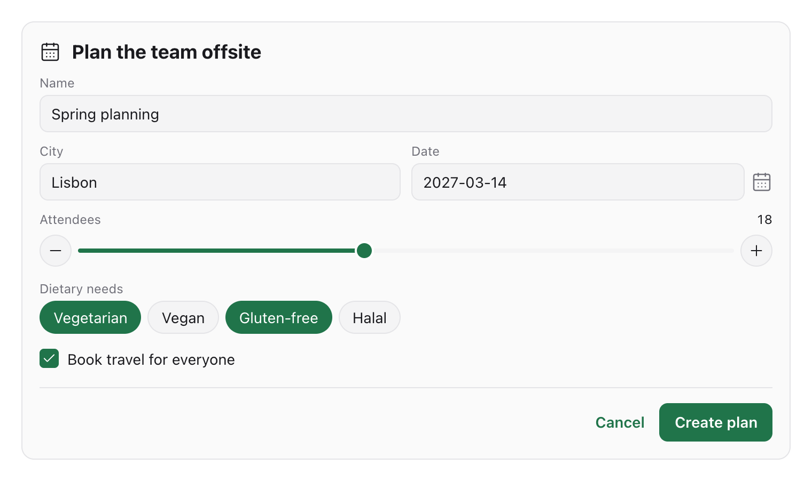

# A2UI for Paseo

A [Paseo](https://paseo.sh) plugin that lets coding agents show interactive [A2UI](https://a2ui.org) interfaces in the chat: forms, pickers, cards, tabs and dashboards. It renders A2UI v1.0 with the basic component catalog using React Native, so interfaces work in the desktop, web, iOS and Android apps.



See [OVERVIEW.md](OVERVIEW.md) for what it does, setup, data access and limits.

## Install

Plugins must be enabled on the daemon (Settings, Plugins, Enable plugins). Then:

```bash
paseo plugin add git:JoeHutchinson/paseo-a2ui
```

Agents receive the `a2ui_render` tool when their next session opens.

## How it works

| Part | Location | Role |
|---|---|---|
| Agent tool | `server/render-tool.ts` | Validates A2UI messages, keeps per-agent surface state, appends a plugin timeline row per surface |
| Turn settling | `server/render-tool.ts` | After each turn, re-appends changed surfaces below the reply and retires older copies |
| Renderer | `client/node.tsx`, `client/surface.tsx` | React Native implementation of the basic catalog, local data model, action dispatch |
| Shared logic | `shared/` | JSON Pointer, expression and function evaluator, regex safety check, message schemas, surface reducer |

Button event actions are sent to the agent as a user message containing the A2UI `action` envelope in an `<a2ui-action>` block.

## Develop

```bash
npm install
npm run typecheck
npm test
paseo plugin install "$PWD"
paseo plugin reload a2ui
```

`fixtures/kitchen-sink.json` is a surface that uses every component; it doubles as a test fixture.

## License

Apache-2.0. See [LICENSE](LICENSE) and [NOTICE](NOTICE).
